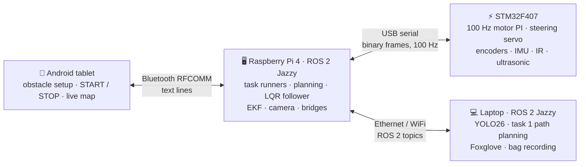

# 🏎️ MDP: Autonomous Mini Ackermann Robot (Group 14)

[](https://alvin0523.github.io/mdp/)
[](https://pixi.sh)
[](https://pixi.sh)
[](https://docs.ros.org/en/jazzy/)
[](https://github.com/Alvin0523/mdp_stm32)
[](https://docs.ultralytics.com/)
[](https://alvin0523.github.io/mdp/)

> An Ackermann-steered robot car that finds and reads image cards around an arena (task 1) and races
> round two obstacles and back to its carpark (task 2), with ROS 2 Jazzy on a Raspberry Pi, STM32
> firmware, YOLO vision and an Android tablet app. The same code drives the real car and a Gazebo sim.

### [📖 Read the Docs →](https://alvin0523.github.io/mdp/) · [🚀 Quickstart →](https://alvin0523.github.io/mdp/quickstart/)

---

## 📖 About

This repository is the workspace for the whole robot: the code repositories as submodules, the
Android app, the 3D-printed parts and the documentation site, all set up with [Pixi](https://pixi.sh).

| Part | Role | Repository |
| --- | --- | --- |
| [`mdp_ros/`](https://github.com/Alvin0523/mdp_ros) | ROS 2 Jazzy on the Pi (and the laptop): task runners, Hybrid A* / Reeds-Shepp planning, LQR path following, EKF localisation, YOLO26 vision, the STM32 and tablet bridges, Gazebo sim, Foxglove | [Alvin0523/mdp_ros](https://github.com/Alvin0523/mdp_ros) (submodule) |
| [`mdp_stm32/`](https://github.com/Alvin0523/mdp_stm32) | STM32F407 firmware (STM32Cube HAL, PlatformIO): 100 Hz wheel-speed PI control, Ackermann steering servo, encoders, ICM-20948 IMU, IR and ultrasonic sensors, binary serial protocol to the Pi | [Alvin0523/mdp_stm32](https://github.com/Alvin0523/mdp_stm32) (submodule) |
| [`mdp_android/`](https://github.com/RashI0192/MDP-APP) | Tablet app (Java): obstacle setup on a 20 × 20 map, Bluetooth link to the Pi, task timers and practice-run analyser | [RashI0192/MDP-APP](https://github.com/RashI0192/MDP-APP) (submodule) |
| [`hardware/`](hardware) | 3D-print files (STL): camera mounts and stands, the "halo" | - |
| [`docs/`](docs) | The [documentation site](https://alvin0523.github.io/mdp/) ([Zensical](https://zensical.org)) | - |

## 🏗️ System Architecture



| Subsystem | What it does | Docs |
| --- | --- | --- |
| 📱 Android | Place obstacles, send them, START / STOP / RESET, show the robot and the images it read | [Android](https://alvin0523.github.io/mdp/android/) · [Tablet link](https://alvin0523.github.io/mdp/rpi/bluetooth/) |
| 🖥️ Raspberry Pi | Runs the tasks: plans the route, follows it, fuses wheel odometry and the IMU (EKF), talks to the STM32 and the tablet | [RPi](https://alvin0523.github.io/mdp/rpi/) |
| 👁️ Vision | YOLO26 on the Pi camera's frames (on the laptop): image IDs for task 1, arrows and bullseyes for task 2 | [Vision](https://alvin0523.github.io/mdp/rpi/vision/) |
| 🧭 Algorithm | Visiting order (every order, scored by Reeds-Shepp lengths), Hybrid A* paths on a costmap, LQR tracking | [Algorithm](https://alvin0523.github.io/mdp/rpi/algorithm/) |
| ⚡ STM32 | Wheel-speed control, steering, sensors, the serial link | [STM32](https://alvin0523.github.io/mdp/stm32/) |

## 🚀 Quick Start

1. Install Pixi (once):

    ```bash
    curl -fsSL https://pixi.sh/install.sh | bash
    ```

2. Clone with the submodules and build the ROS workspace:

    ```bash
    git clone --recurse-submodules https://github.com/Alvin0523/mdp.git
    ```

    ```bash
    cd mdp/mdp_ros && pixi install && pixi run build
    ```

    Already cloned without `--recurse-submodules`? Run `git submodule update --init --recursive`.

3. Try task 1 in the sim (from `mdp_ros/`, second terminal for `start`):

    ```bash
    pixi run sim task:=1
    ```

    ```bash
    pixi run start
    ```

👉 The real car (Pi + laptop + tablet), calibration, task 2 and every launch argument:
[Quickstart](https://alvin0523.github.io/mdp/quickstart/). Firmware build and flashing:
[STM32](https://alvin0523.github.io/mdp/stm32/).

The docs site locally, from this folder: `pixi install`, then `pixi run serve` (http://127.0.0.1:8000).

## 📁 Repository Structure

```
mdp/
├── mdp_ros/          # submodule - ROS 2 workspace (Pi + laptop + sim)
├── mdp_stm32/        # submodule - STM32 firmware
├── mdp_android/      # submodule - the tablet app (RashI0192/MDP-APP)
├── hardware/         # 3D-print files (STL): camera mounts, halo
├── docs/             # documentation site
│   ├── quickstart.md          # commands: setup, sim, real car, calibration
│   ├── assessment_checklist.md
│   ├── android/  rpi/  stm32/ # per subsystem
│   └── hardware.md  dev_workflow.md  troubleshooting.md  references.md
├── pixi.toml         # docs site tasks (serve, build)
└── zensical.toml     # docs site config
```

## 👥 Team

**Group 14** - NTU College of Computing & Data Science, Multidisciplinary Project, AY2026/27 Semester 1

| Name | Area |
| --- | --- |
| Wong Wei Ming | Raspberry Pi, Algorithm |
| Wang Li Ling, Katie | Raspberry Pi |
| Ojha Rashi | Algorithm, Android |
| Lin Lihong Albert | Android |
| Keagan Kong Kai Yi | Vision |
| Cheong Hoi Chun | STM32 |
| Seah Song Li | STM32 |
