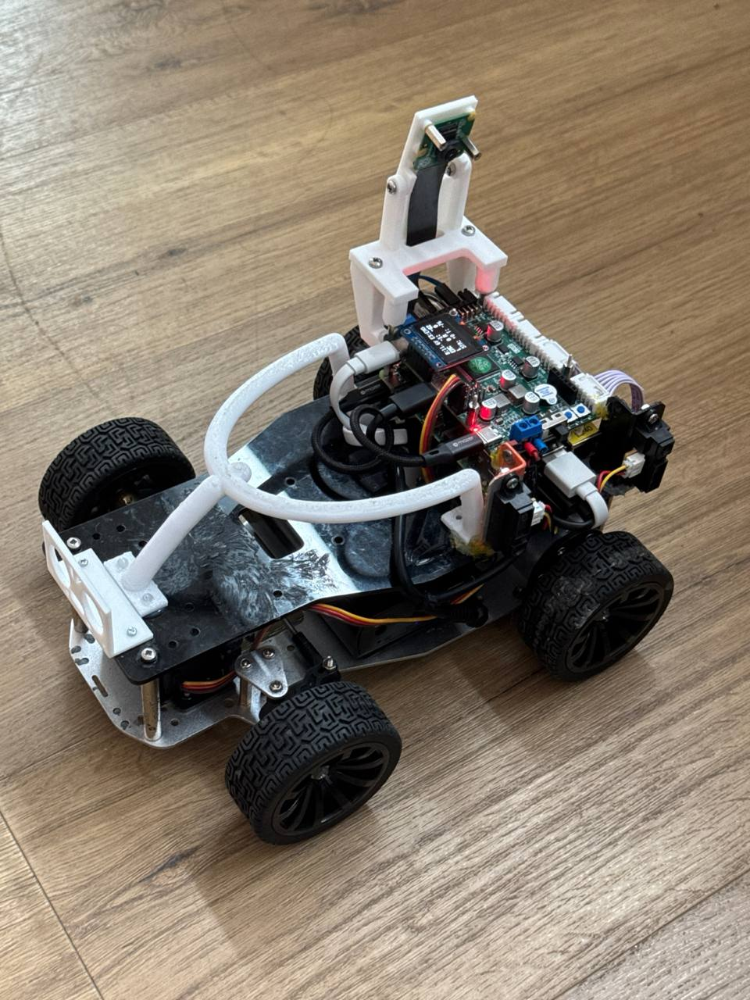
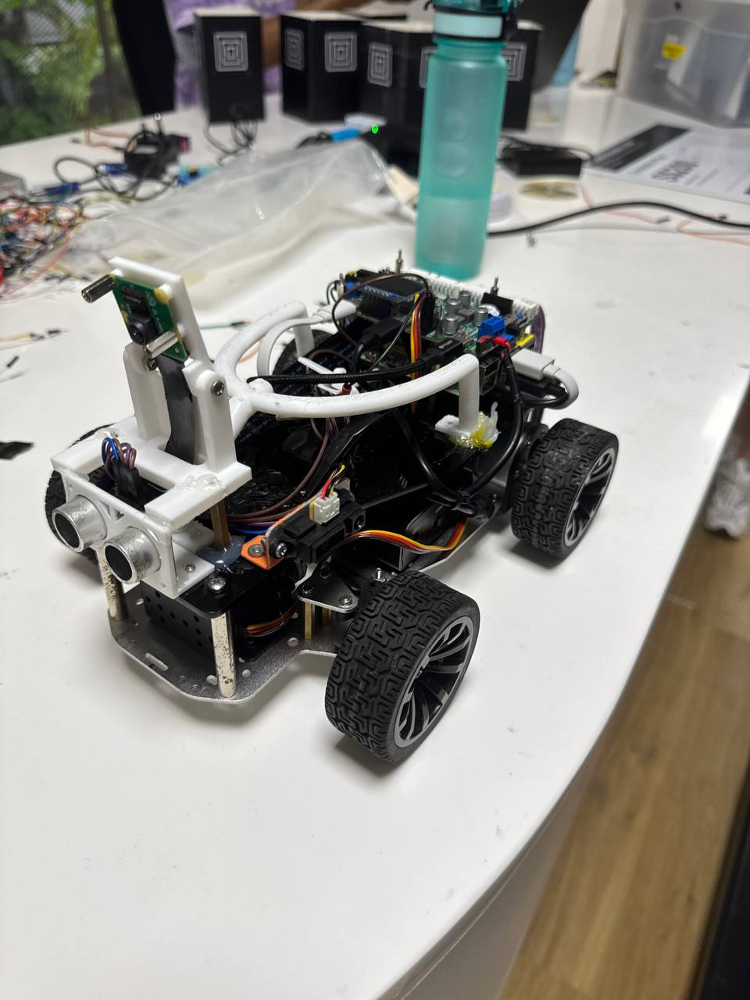
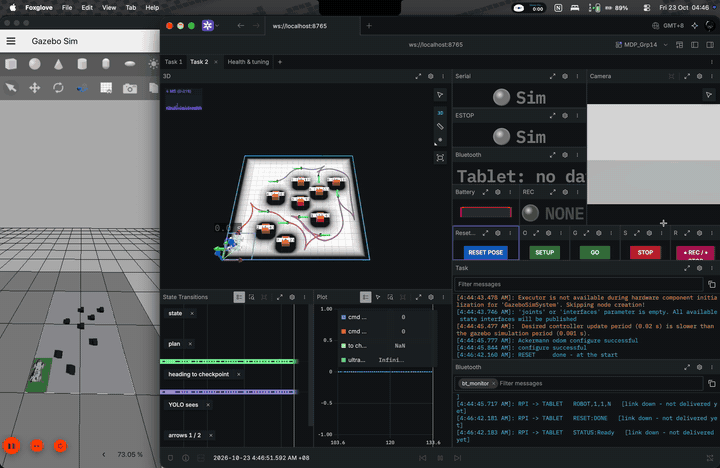
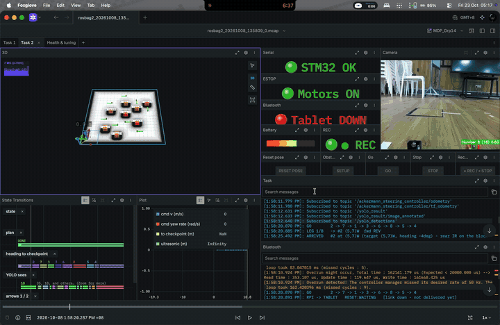
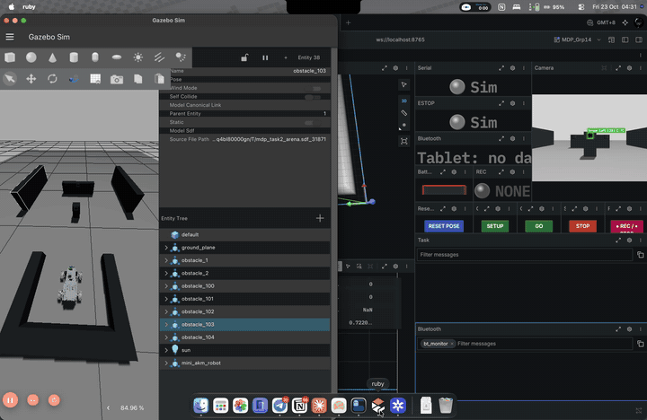
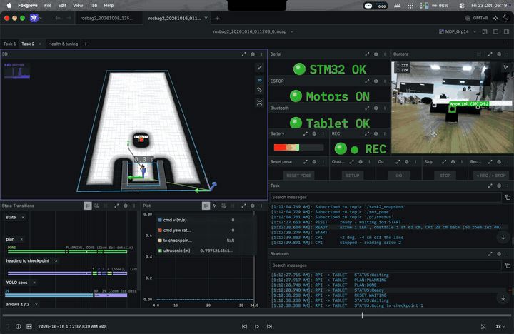
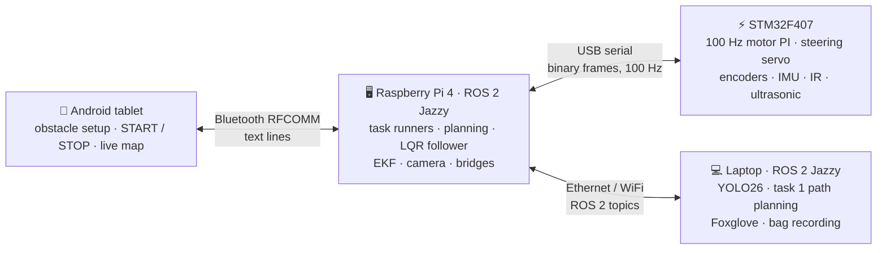

# 🏎️ MDP: Autonomous Mini Ackermann Robot (Group 14)

**🏆 First approved ROS2 Team in MDP**

[](https://alvin0523.github.io/mdp/)
[](https://alvin0523.github.io/mdp/)
[](https://pixi.sh)
[](https://pixi.sh)

[](https://docs.ros.org/en/jazzy/)
[](https://control.ros.org/jazzy/)
[-22314E?logo=ros)](https://docs.ros.org/en/jazzy/p/robot_localization/)
[](https://cyclonedds.io/)
[](https://gazebosim.org/)
[](https://foxglove.dev/)
[](https://alvin0523.github.io/mdp/rpi/algorithm/)

[-111F68)](https://docs.ultralytics.com/)
[](https://pytorch.org/)
[](https://www.python.org/)
[](https://tailscale.com/)

[](https://github.com/Alvin0523/mdp_stm32)
[](https://platformio.org/)
[](https://github.com/Alvin0523/mdp_stm32)
[-3DDC84?logo=android&logoColor=white)](https://github.com/RashI0192/MDP-APP)

> An Ackermann-steered robot car that finds and reads image cards around an arena (task 1) and races
> round two obstacles and back to its carpark (task 2), with ROS 2 Jazzy on a Raspberry Pi, STM32
> firmware, YOLO vision and an Android tablet app. The same code drives the real car and a Gazebo sim.

### [📖 Read the Docs →](https://alvin0523.github.io/mdp/) · [🚀 Quickstart →](https://alvin0523.github.io/mdp/quickstart/)

> [!NOTE]
> While task 2 was being tuned, some parts of the car may have been adjusted (a sensor moved, a
> setting changed) without the docs catching up. If something does not match what you see, contact
> **Wei Ming** ([@Alvin0523](https://github.com/Alvin0523)).

---

## 📖 About

This repository is the workspace for the whole robot, set up with [Pixi](https://pixi.sh). The code
lives in three **git submodules** (each its own repository); the rest is in this repository.

**Submodules** (`git clone --recurse-submodules` fetches them):

| Folder | What |
| --- | --- |
| [`mdp_ros/`](https://github.com/Alvin0523/mdp_ros) | ROS 2 Jazzy on the Pi (and the laptop): task runners, Hybrid A* / Reeds-Shepp planning, LQR path following, EKF localisation, YOLO26 vision, the STM32 and tablet bridges, Gazebo sim, Foxglove |
| [`mdp_stm32/`](https://github.com/Alvin0523/mdp_stm32) | STM32F407 firmware (STM32Cube HAL, PlatformIO): 100 Hz wheel-speed PI control, Ackermann steering servo, encoders, ICM-20948 IMU, IR and ultrasonic sensors, binary serial protocol to the Pi |
| [`mdp_android/`](https://github.com/RashI0192/MDP-APP) | Android tablet app (Java): obstacle setup on a 20 × 20 map, Bluetooth link to the Pi, task timers and practice-run analyser |

**In this repository:**

| Folder | What |
| --- | --- |
| [`docs/`](docs) | The [documentation site](https://alvin0523.github.io/mdp/) ([Zensical](https://zensical.org)) |
| [`hardware/`](hardware) | 3D-print files (STL): camera mounts and stands, the "halo" |

## 📷 The Car

| Task 1 setup | Task 2 setup |
| :---: | :---: |
|  |  |
| Camera on a mast, looking left - reads the images while parked beside or driving past them | Camera forward at the arrows, ultrasonic at the front for the distances |

## 🏁 Results

| Task | Goal | Result | Time | Video |
| --- | --- | --- | --- | --- |
| **Task 1** - image recognition | Read every image on the obstacles | 7 / 8 images (rank 6, fastest in the top 10) | 52 s | _TBD_ |
| **Task 2** - fastest car | Round both obstacles and back to the carpark | Rank 1 | 8 s | _TBD_ |

## 🎬 Videos

The same code in Gazebo and on the real car, both watched in Foxglove (the real runs played back from
their bags). Sim and real are example runs, not the same obstacle layout. Previews sped up; click for
the full video.

| | Simulation (Gazebo) | Real car (bag playback) |
| :---: | :---: | :---: |
| **Task 1** - every image (4x) | [](docs/images/sim-task1.mp4) | [](docs/images/real-task1.mp4) |
| **Task 2** - fastest car (1.5x) | [](docs/images/sim-task2.mp4) | [](docs/images/real-task2.mp4) |

## 🏗️ System Architecture



| Subsystem | What it does | Docs |
| --- | --- | --- |
| 📱 Android | Place obstacles, send them, START / STOP / RESET, show the robot and the images it read | [Android](https://alvin0523.github.io/mdp/android/) · [Tablet link](https://alvin0523.github.io/mdp/rpi/bluetooth/) |
| 🖥️ Raspberry Pi | Runs the tasks: plans the route, follows it, fuses wheel odometry and the IMU (EKF), talks to the STM32 and the tablet | [RPi](https://alvin0523.github.io/mdp/rpi/) |
| 👁️ Vision | YOLO26 on the Pi camera's frames (on the laptop): image IDs for task 1, arrows and bullseyes for task 2 | [Vision](https://alvin0523.github.io/mdp/rpi/vision/) |
| 🧭 Algorithm | Visiting order (every order, scored by Reeds-Shepp lengths), Hybrid A* paths on a costmap, LQR tracking | [Algorithm](https://alvin0523.github.io/mdp/rpi/algorithm/) |
| ⚡ STM32 | Wheel-speed control, steering, sensors, the serial link | [STM32](https://alvin0523.github.io/mdp/stm32/) |

## 🚀 Quick Start

1. Install Pixi (once):

    ```bash
    curl -fsSL https://pixi.sh/install.sh | bash
    ```

2. Clone with the submodules and build the ROS workspace:

    ```bash
    git clone --recurse-submodules https://github.com/Alvin0523/mdp.git
    ```

    ```bash
    cd mdp/mdp_ros && pixi install && pixi run build
    ```

    Already cloned without `--recurse-submodules`? Run `git submodule update --init --recursive`.

3. Try task 1 in the sim (from `mdp_ros/`, second terminal for `start`):

    ```bash
    pixi run sim task:=1
    ```

    ```bash
    pixi run start
    ```

👉 The real car (Pi + laptop + tablet), calibration, task 2 and every launch argument:
[Quickstart](https://alvin0523.github.io/mdp/quickstart/). Firmware build and flashing:
[STM32](https://alvin0523.github.io/mdp/stm32/).

The docs site locally, from this folder: `pixi install`, then `pixi run serve` (http://127.0.0.1:8000).

## 📁 Repository Structure

```
mdp/
├── mdp_ros/          # submodule - ROS 2 workspace (Pi + laptop + sim)
├── mdp_stm32/        # submodule - STM32 firmware
├── mdp_android/      # submodule - the tablet app (RashI0192/MDP-APP)
├── hardware/         # 3D-print files (STL): camera mounts, halo
├── docs/             # documentation site
│   ├── quickstart.md          # commands: setup, sim, real car, calibration
│   ├── assessment_checklist.md
│   ├── android/  rpi/  stm32/ # per subsystem
│   └── hardware.md  dev_workflow.md  troubleshooting.md  references.md
├── pixi.toml         # docs site tasks (serve, build)
└── zensical.toml     # docs site config
```

## 👥 Team

**Group 14** - NTU College of Computing & Data Science, Multidisciplinary Project, AY2026/27 Semester 1

[](https://github.com/Alvin0523)
[](https://github.com/ymkatie)
[](https://github.com/RashI0192)
[](https://github.com/Albert-Lin227)
[](https://github.com/kekgan)
[](https://github.com/Yeet94)
[](https://github.com/seahsongli)

| Name | Area | GitHub |
| --- | --- | --- |
| Wong Wei Ming | Raspberry Pi, Algorithm | [@Alvin0523](https://github.com/Alvin0523) |
| Wang Li Ling, Katie | Raspberry Pi | [@ymkatie](https://github.com/ymkatie) |
| Ojha Rashi | Algorithm, Android | [@RashI0192](https://github.com/RashI0192) |
| Lin Lihong Albert | Android | [@Albert-Lin227](https://github.com/Albert-Lin227) |
| Keagan Kong Kai Yi | Vision | [@kekgan](https://github.com/kekgan) |
| Cheong Hoi Chun | STM32 | [@Yeet94](https://github.com/Yeet94) |
| Seah Song Li | STM32 | [@seahsongli](https://github.com/seahsongli) |