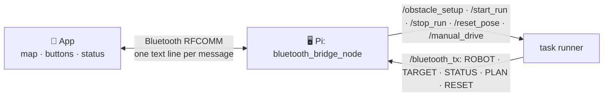

# Android (`mdp_android`)

The tablet app (Java, Samsung Galaxy Tab A7 Lite): set up the obstacles on a 20 × 20 map, start
and stop the run, and watch the robot's position, status and the images it read. It talks only to
the Raspberry Pi, over Bluetooth - the STM32, vision and planning never see its traffic, only the
Pi's ROS topics. Source: the `mdp_android/` submodule
([RashI0192/MDP-APP](https://github.com/RashI0192/MDP-APP)). Rubric: [Assessment &
Checklist](../assessment_checklist.md), Module C.

## Screens

| Screen | What it does |
| --- | --- |
| **Home** | The map with the robot, the movement pad, task timers and **START RPI RUN** |
| **Map configuration** | Set the start point, add / drag / change / delete obstacles, manual X / Y / facing entry, save, reset the map |
| **Bluetooth** | Turn Bluetooth on, scan, pick the Pi, connect / disconnect, link status |
| **Communications** | Message log, **START** / **STOP**, **SEND OBSTACLES**, **RESET POST**, detected-image gallery |

## App → Pi: what each control sends

| In the app | Line sent | What the Pi does |
| --- | --- | --- |
| **SEND OBSTACLES** | `OBSTACLE,<n>,<col>,<row>,<N\|E\|S\|W>` for each obstacle, then `DONE` | Takes the set (cells `0`–`19`, the facing = the image side) and plans task 1. Tablet: **PLAN: PLANNING** → **DONE** |
| **RESET POST** | `RESET` | The car is at the start: resets the pose. Tablet: **RESET: DONE** |
| **START RPI RUN** / **START** / **TASK 1 START** / **TASK 2 START** | `BEGIN` - see below | Should start the run (`/start_run`), once **Ready** |
| **STOP** (and the task buttons while running) | `STOP` | Emergency stop: zero velocity, reset before the next run |
| Movement pad ↑ ↓ ↖ ↗ ↙ ↘ | `f` `b` `fl` `fr` `bl` `br` | One short drive burst per tap (only after **Set Start Point**) |

!!! warning "Start sends `BEGIN`; the Pi only accepts `START`"
    Every start button sends `BEGIN` (`ControlFragment.java`, 5 places), which the Pi rejects as
    an unrecognised line - start from the laptop (`pixi run start`) or Foxglove until the app sends
    `START`.

## Pi → app: what each line shows

| Line from the Pi | In the app |
| --- | --- |
| `ROBOT,<col>,<row>,<N\|E\|S\|W>` | The robot on the map: the cell under the middle of its rear axle, and its heading. Sent on change and every 2 s |
| `TARGET,<n>,<id>` | Task 1: obstacle *n*'s image ID, on the map and in the detected-image gallery |
| `STATUS:<text>` | The status line: `Waiting`, `Ready`, `Going to obstacle n`, `Scanning obstacle n`, `Going to checkpoint n`, `Finished`, `Stopped`. `Going …` / `Scanning …` start the run timer, `Finished` / `Stopped` stop it |
| `PLAN:<WAITING\|PLANNING\|DONE>` | The **Plan** indicator |
| `RESET:<WAITING\|DONE>` | The **Reset** indicator |
| `FINISHED` | Not handled (logged as unknown); `STATUS:Finished`, sent with it, stops the timer |

*Ready* = **PLAN: DONE** and **RESET: DONE** - only then does the Pi accept a start. The latest
`ROBOT`, `PLAN`, `RESET` and `STATUS` lines are resent whenever the link comes back up. Pairing,
the Pi's setup, testing the link and troubleshooting: [Tablet link (Bluetooth)](../rpi/bluetooth.md).

## A task 1 run from the tablet

1. **Bluetooth** screen → connect to the Pi (`LINK UP` in `pixi run btlog` on the laptop).
2. **Map configuration** → place the obstacles (tap, drag, or manual X / Y / facing).
3. **SEND OBSTACLES** → wait for **PLAN: DONE**.
4. Car in the start box → **RESET POST** → **RESET: DONE**; the status shows **Ready**.
5. Start (see the warning above) → the robot moves on the map, images appear as they are read.
6. **STOP** at any time. To run again: car back, **RESET POST**, start - the obstacles are kept.

## Features

| Area | What the app has |
| --- | --- |
| Map | 20 × 20 grid with coordinate labels; the robot as a 2 × 2 footprint with its heading; obstacle numbers and facing markers; explored cells shaded |
| Obstacles | Add, drag and drop, change image / facing, tap-to-delete (one mode at a time); manual X / Y / N-E-S-W entry and a list of current obstacles; numbering kept tidy after deletions; occupancy checked before placing |
| Map storage | Save and reload the obstacle map; reset with a confirmation |
| Robot | Start-point and heading selection; six-direction movement pad, blocked until a start point is set and checked against obstacles; live position and status |
| Bluetooth | On / off, scan, paired and discovered devices, connect, disconnect handling, link-health status; every line ends in `\n` |
| Messages | Scrolling message log, manual text entry, detected-image gallery (no duplicates, clear button) |
| Timers and practice | Task 1 and task 2 timers (start, pause / resume, stop, reset); practice mode for both tasks with lapses and editable notes; saved practice history and a results analyser |
| Look | White grid, pale-gold explored cells, gold buttons; smoother Bluetooth, caching and grid loading; no toast pop-ups while editing |
