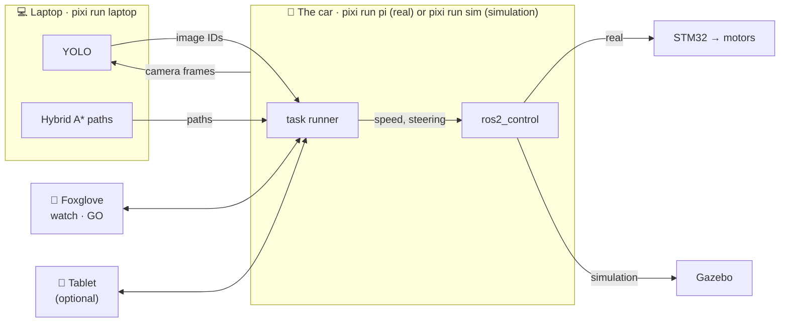
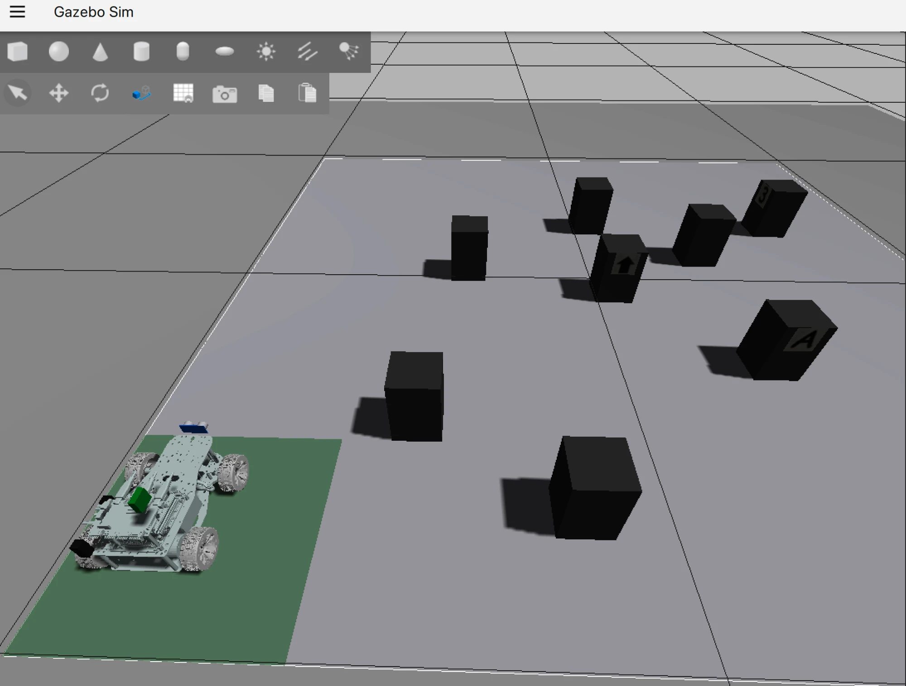
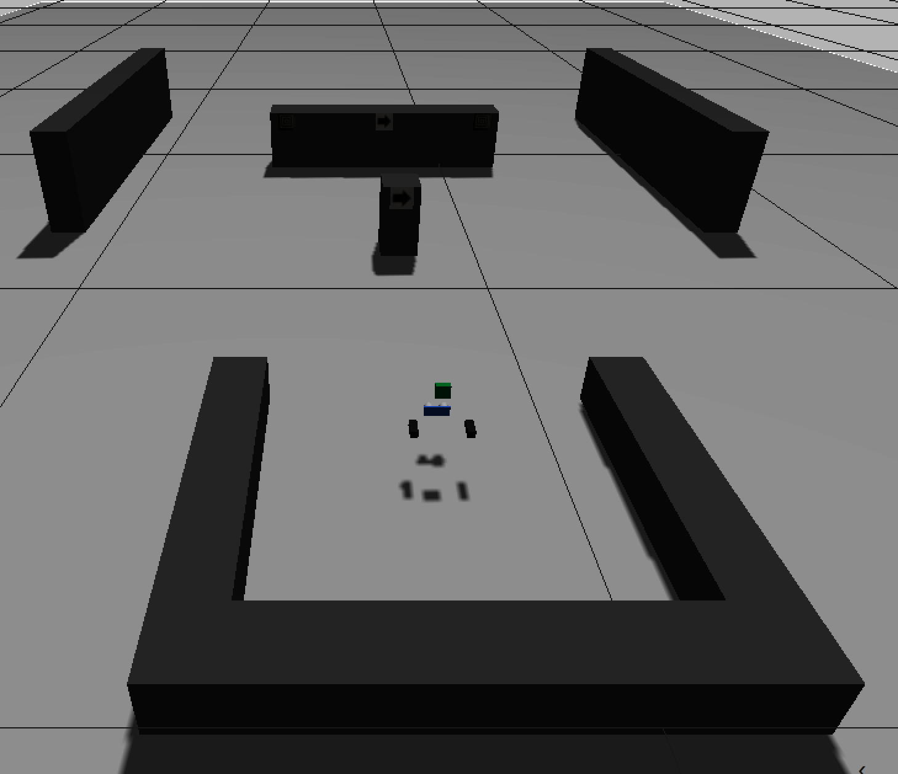
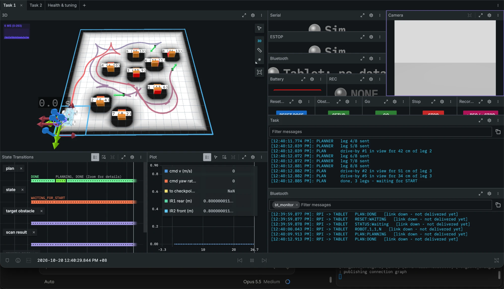
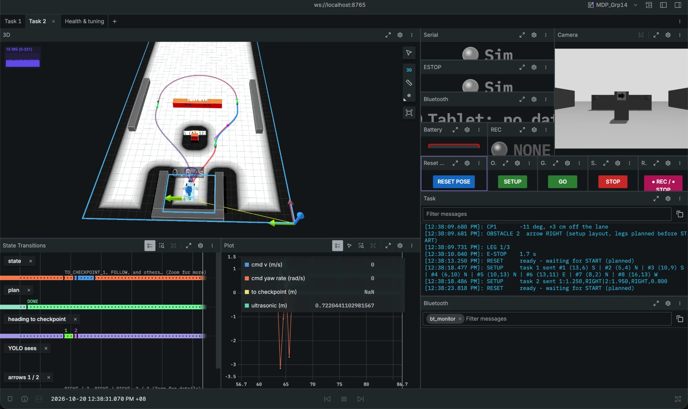
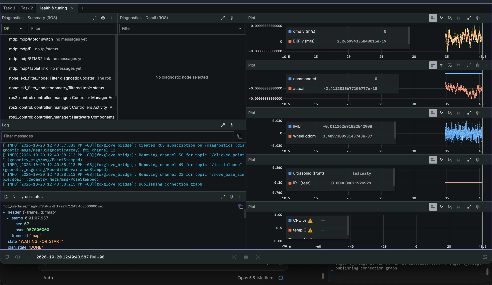
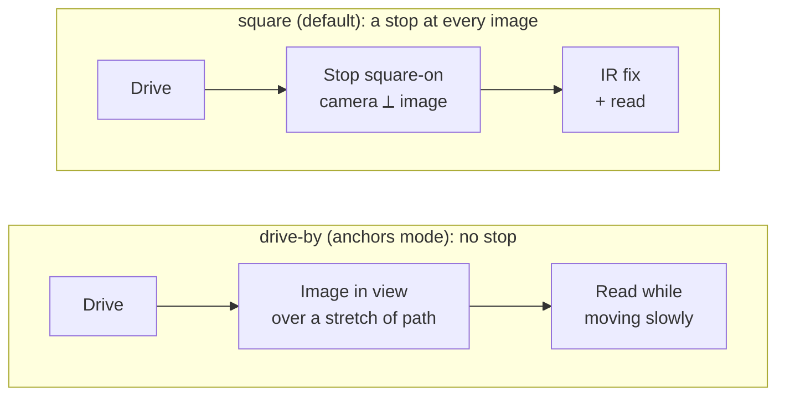

# Quickstart

How to run the car, in simulation or for real, and every number we measured.



**Simulation and real deployment run the same code.** Only the last step differs: `ros2_control`
drives the STM32 on the real car and Gazebo's car in simulation
([ROS2 Control](rpi/ros2_control.md)). So the steps below are the same for both.

Commands run **from `mdp_ros/`**. Positions are **tablet cells**: column, row `0`–`19` (10 cm,
`(0,0)` bottom-left) and `N` `E` `S` `W`.

!!! tip "This docs site locally"
    From the `mdp` repo root: `pixi install`, then `pixi run serve` → `http://127.0.0.1:8000`.

---

## 1. Install

!!! info "Everything runs with pixi"
    [Pixi](https://pixi.sh) installs the whole stack (ROS 2, Gazebo, YOLO, the STM32 toolchain)
    per project, from one lock file - like uv, but for conda and PyPI packages together. No
    `sudo apt`, no system ROS: `pixi install`, then `pixi run <task>`.

    | Platform | |
    | --- | --- |
    | macOS (Apple silicon) · Linux (x86 or ARM, e.g. the Pi) | Supported: the repos are locked for `osx-arm64`, `linux-64`, `linux-aarch64` |
    | Windows | Use **WSL** (Linux): only the scripts differ from macOS and Linux. Native Windows could work with minor changes, untested |

    **Docker** is not recommended for a stack that changes this fast across platforms. Use it
    for deployment, or when you need CUDA or a specific kernel or driver - pixi runs inside Docker
    too.

=== "💻 Simulation"

    Everything runs on the laptop.

    ```bash
    git clone --recurse-submodules https://github.com/Alvin0523/mdp.git
    cd mdp/mdp_ros
    pixi install
    pixi run build
    ```

    Install the [Foxglove](https://foxglove.dev/download) app - every run is watched and driven
    from it ([Foxglove](#foxglove)). Optional: [zellij](https://zellij.dev) for one-window runs.

=== "🤖 Real deployment"

    The laptop and the Raspberry Pi. **On the laptop**: the same as for the simulation - clone,
    `pixi install`, `pixi run build`, the Foxglove app.

    **On the Pi**: SSH in from the laptop over Tailscale (`ssh grp14@100.102.151.31`,
    [Network](rpi/network.md)), then:

    ```bash
    git clone --recurse-submodules https://github.com/Alvin0523/mdp.git
    cd mdp/mdp_ros
    pixi install
    pixi run build
    pixi run realtime   # once: real-time priority for the controller loop (sudo; log in again after)
    ```

    **Flash the STM32** (ST-Link on the board's SWD header, ST-Link USB into the Pi):

    ```bash
    cd ../mdp_stm32
    pixi install
    pixi run probe      # ST-LINK/V2 + STM32F407 detected?
    pixi run build
    pixi run flash
    pixi run monitor    # optional: boot banner, LED blink, OLED pages
    pixi run udev       # once, board plugged in: /dev/stm32_serial (car link) + /dev/stm32_flash (asks for sudo)
    ```

    ARM64 hosts (the Pi) may need a `platform_packages` override if `build` fails, see
    [Troubleshooting](troubleshooting.md).

!!! warning "After pulling big changes: clean build"
    If a package changed type or files were renamed, old build files get in the way:

    ```bash
    pixi run clean
    pixi run build
    ```

---

## 2. Run

Three terminals: **the car**, **the laptop**, **Foxglove** (the diagram above).

=== "💻 Simulation"

    Gazebo opens a 3D window with the arena, the obstacles and the car; everything else is the
    same code as on the real car.

    === "Task 1"

        

        ```bash
        pixi run sim task:=1                  # terminal 1: Gazebo, obstacles from config/tasks.yaml
        pixi run laptop sim:=true task:=1     # terminal 2: YOLO + path planning
        pixi run foxglove                     # terminal 3: then open Foxglove, tab Task 1
        ```

        The obstacles are sent by themselves; once Foxglove shows the plan, press **GO** in
        Foxglove (or `pixi run start`).

        Run again: **RESET POSE** (also puts the Gazebo car back), then **GO**.

        | Optional | How |
        | --- | --- |
        | Tablet | Add `obstacles:=tablet` to terminal 1 and [connect the tablet](#connecting-the-tablet) to the laptop (Linux or macOS). Place the obstacles → **DONE** → **RESET** → **START**. Gazebo's blocks move to match |
        | Step-through | Add `step:=true` to terminal 1; then `pixi run step` instead of `start` - SPACE drives to the next stop |
        | One window | `pixi run sim-car task:=1` (zellij) instead of terminals 1-3, same options |
        | No Gazebo window | Add `gui:=false` to terminal 1 |

    === "Task 2"

        

        ```bash
        pixi run sim task:=2                  # terminal 1: Gazebo, the course from tasks.yaml (task2 -> sim)
        pixi run laptop sim:=true task:=2     # terminal 2: YOLO + path planning
        pixi run foxglove                     # terminal 3: then open Foxglove, tab Task 2
        ```

        Once the path to checkpoint 1 shows, press **GO** in Foxglove (or `pixi run start`).
        Run again: **RESET POSE**, then **GO**.

        | Optional | How |
        | --- | --- |
        | Tablet | [Connect it](#connecting-the-tablet) to the laptop (Linux or macOS); **START** / **STOP** from the app |
        | Step-through | Add `step:=true` to terminal 1; then `pixi run step` - one checkpoint per SPACE, with a live preview ([Task 2](#5-task-2-fastest-car)) |
        | One window | `pixi run sim-car task:=2` (zellij) instead of terminals 1-3 |
        | Another course | Edit `task2` → `sim` in `config/tasks.yaml` (d1, d2, arrows, bar width), restart terminal 1 |

    === "Bare car"

        Manual driving and calibration, no task:

        ```bash
        pixi run sim                          # terminal 1
        pixi run laptop sim:=true             # terminal 2
        pixi run foxglove                     # terminal 3
        pixi run teleop                       # or pixi run calib ... (section 7)
        ```

=== "🤖 Real deployment"

    The Pi and the laptop on a WiFi with internet, Tailscale up on both
    ([Network](rpi/network.md)). Car powered, motor switch on.

    === "Task 1"

        ```bash
        pixi run pi task:=1                   # on the Pi (SSH)
        pixi run laptop task:=1               # on the laptop
        pixi run foxglove                     # on the laptop: then open Foxglove, tab Task 1
        ```

        **With the tablet** (the real run): [connect it](#connecting-the-tablet) → place the
        obstacles → **DONE** (wait for **PLAN: DONE**) → car in the start box → **RESET** →
        **START**. **STOP** = emergency stop.

        **Without the tablet:** start the Pi with `pixi run pi task:=1 obstacles:=yaml` (the
        obstacles from `config/tasks.yaml`), then **RESET POSE** and **GO** in Foxglove.

        | Optional | How |
        | --- | --- |
        | Step-through | Add `step:=true` on the Pi; then `pixi run step` on the laptop |
        | One window | `pixi run car task:=1` on the laptop (zellij): SSHes into the Pi and starts all three |

    === "Task 2"

        ```bash
        pixi run pi task:=2                   # on the Pi (SSH)
        pixi run laptop task:=2               # on the laptop
        pixi run foxglove                     # on the laptop: then open Foxglove, tab Task 2
        ```

        Car in the carpark, facing out. Once the path to checkpoint 1 shows: **GO** in Foxglove,
        or **START** on the tablet.

        | Optional | How |
        | --- | --- |
        | Step-through | Add `step:=true` on the Pi; then `pixi run step` on the laptop |
        | One window | `pixi run car task:=2` on the laptop (zellij) |

    === "Bare car"

        ```bash
        pixi run pi                           # on the Pi
        pixi run laptop                       # on the laptop
        pixi run foxglove                     # on the laptop
        pixi run teleop                       # or pixi run calib ... (section 7), on the laptop
        ```

- **The tablet link is always on**: a tablet can connect to any run and send obstacles, START,
  STOP, RESET or the drive buttons.
- **Camera + YOLO are on by default**; `vision:=false` turns them off. Every option:
  [Launch arguments](#launch-arguments).
- **The car starts** with the middle of its rear axle over cell **(1,1) facing N**
  (`start_cell:=` / `start_dir:=`). Task 2 starts in the carpark facing E.

### Foxglove

Every run is watched and driven from [Foxglove](https://foxglove.dev/download). `pixi run foxglove`
on the laptop, then in the app: **Open connection** → `ws://localhost:8765`, and import the layout
`mdp_ros/foxglove/MDP_Grp14.json` once (again after it changes).

=== "Task 1"

    

    3D arena with the obstacles, costmap, checkpoints and path; the camera; state timeline; lights
    (STM32, motors, tablet, **● REC**); battery; the run's log and the tablet traffic. Buttons
    **RESET POSE · SETUP · GO · STOP · REC**.

=== "Task 2"

    

    The same for task 2: the course and walls, checkpoints 1-4 and the route round the bar, the
    camera on the arrows, the ultrasonic.

=== "Health & tuning"

    

    Diagnostics (incl. the Pi's CPU / memory / temperature), all logs, `/run_status`, and speed /
    steering / yaw-rate / range plots.

**REC** records a bag on the laptop (`mdp_ros/bags/`); **SETUP** sends `tasks.yaml`'s obstacles
like the tablet's DONE.

### If the laptop is gone

The car plans its paths itself after 2 s without an answer; image scans report `UNKNOWN`.

### Connecting the tablet

Pair the tablet with the machine running the car's half (the Pi; for the simulation the
laptop, Linux or macOS) once in Bluetooth settings, then open the link before starting (keep this terminal open):

```bash
sudo rfcomm listen /dev/rfcomm0 1
```

The app connects; `LINK UP` shows in `pixi run btlog` and the tablet gets the car's position.
First time on a Pi (pairing, Serial Port service), the messages and troubleshooting:
[Tablet link (Bluetooth)](rpi/bluetooth.md).

---

## 3. Before a real run (checklist)

1. **Battery**: OLED page 1 `B:xx.xV`; charge if low.
2. **Motor switch** (`PD3`) **ON**: OLED `ES:RDY`; Foxglove light *Motors ON*.
3. **STM32 plugged in**: the Foxglove light *STM32 OK* once running.
4. **Tablet connected**: *Tablet OK* light, `LINK UP` in `pixi run btlog`.
5. **Car in the start box**, cell (1,1) facing N → RESET → tablet **RESET: DONE**.
6. **Obstacles sent** → **PLAN: DONE** → tablet status **Ready** → START.

---

## 4. Task 1 (explore + recognise)

Steps are the same in sim and real; the **tablet** and **no-tablet** columns do the same thing.

| Step | With the tablet | Without (second terminal, `mdp_ros/`) | You'll see |
| --- | --- | --- | --- |
| 1. Obstacles | Place them, press **DONE** | nothing (`tasks.yaml` is sent at start), or `pixi run setup` to send it again | `OBSTACLES #1 (5,10)S …` |
| 2. Wait for the plan | tablet **PLAN: DONE** | | `PLAN      done, 4 legs - waiting for START` |
| 3. Car in the start box, reset | **RESET** | `pixi run reset` | `RESET     done - at the start`, tablet **RESET: DONE** |
| 4. Start | **START** (needs STATUS *Ready*) | `pixi run start` (Foxglove **GO**) | `START     1 -> 2 -> 4 -> 3` |
| 5. Stop any time | **STOP** | `pixi run stop` | `STOP      at (9,5)E - reset before the next run` |

What the launch terminal prints during a run (one line per event, cells not metres):

```text
LEG 1/4   -> #1 (5,8)E  fwd REV fwd
ARRIVED   #1 at (5,8)E (target (5,8)E, heading -8deg) - scanning
TARGET    #1 = 20   (YOLO saw 20x22)
...
FINISHED  all obstacles visited
```

- At each stop the car waits up to 3 s while YOLO looks, then sends `TARGET,<obstacle>,<id>` to the
  tablet (`UNKNOWN` if it saw nothing). What YOLO reads for that image in the last 35 cm of the
  approach already counts, so a stop can be over sooner.
- **Two ways to visit the images** (`navigation.yaml` → `task1_runner` → `visit.mode`):

    | `visit.mode` | Stops | Position fix |
    | --- | --- | --- |
    | `square` (default) | A square-on stop at every image; where it does not fit, the stop slides along the face (up to 10 cm) or back (up to 13 cm); no spot at all: skipped | IR at every stop that stays within 3 cm of the block's centre |
    | `anchors` (faster, [future work](#task-1-stop-less-drive-bys)) | **Anchors** (square-on stops) + **drive-bys** (images read while driving past, at `visit.drive_by_speed`) + **angled** stops where no square stop fits + an angled **last** stop | IR at every anchor |

    In `anchors` mode the plan picks the anchors (log `PLAN      #13 anchor, drive-by #16 on the
    way`); a drive-by not read by the end is visited square after the last stop
    (`DRIVE-BY  #16 not read - a stop for it now`). Change it with `ros2 param set /task1_runner
    visit.mode anchors`; it takes effect at the next obstacle set (DONE / `pixi run setup`).
- **Run again:** put the car back in the start box → RESET → START. The obstacles and plan are kept.
  A reset during a run stops the run first.
- **Step through** (testing): add `step:=true` to `pixi run pi` / `sim`, then `pixi run step`. SPACE
  starts the run; at each stop the car does everything a real run does (IR approach, creep and
  position fix, scan, `TARGET`), logs `STEP      SPACE for leg 2/4 -> #3`, and holds until the
  next SPACE. The run timer keeps running.
- **In sim, reset also puts the Gazebo car back at the start** (it teleports it), so you can run
  again without restarting the sim: `pixi run reset`, then `pixi run start`.

---

## 5. Task 2 (fastest car)

How to start it: [Run](#2-run). No obstacles to send and no reset needed. The distances are unknown (d1, d2 each 0.60–1.50 m), so
the car measures them on the way. Four checkpoints: **1** beside obstacle 1 (arrow 1's side),
**2** beside the bar's end on arrow 2's side, **3** beside its other end, **4** home.

| Step | The car | Ends when |
| --- | --- | --- |
| Before START | In the carpark: the ultrasonic measures obstacle 1, YOLO reads arrow 1 → checkpoint 1 and its path planned | START |
| → CP1 | Straight (`straight_speed`), an S to arrow 1's side, straight into checkpoint 1 (`cp1_speed` over the last `line_up_dist`). On the way: YOLO reads arrow 2, the ultrasonic measures the bar, the camera sees arrow 2 + the bullseye on the bar's near end | At checkpoint 1 (`cp1_back` behind obstacle 1, `lane_offset` out) |
| At CP1 | The bar's width ([below](#bar-width)); checkpoints 2–4 planned; CP1 → CP2 from the [route table](#route-table). A reading missing: it stops and looks | Planned |
| → CP2 → CP3 | An S to checkpoint 2 (`side_clearance` out from the bar's end), half a circle round the back of the bar | At checkpoint 3 |
| → Home | An S onto the centre line (`home_straight_dist` out), straight in | [Home](#home) |

The terminal: `READY`, `START`, `CP1 …`, `OBSTACLE 2  …`, `LEG 1/3` … `3/3`, `FINISHED  23.6 s
(the back wall)`. Foxglove shows it like task 1: costmap, blocks, walls, checkpoints and the path.

### Bar width

| Reading | Width planned with |
| --- | --- |
| Arrow 2 → the near bullseye in **one frame** × the ultrasonic's distance (× `bar_gap_scale` 1.065 on the real car: lens distortion; 1.0 in sim) | That, to the **nearest** 5 cm (not up: the side walls stand off the bar's real ends) |
| No such frame | The usual **60 cm** (`tasks.yaml` `task2` `obstacle_2` size) |

(A "pose" method - one bullseye + the car's own pose - was dropped: it read 42–52 cm for a 76 cm
bar.)

### Home

The home checkpoint is `HOME_DEEPER_M` (5 cm) past the carpark's middle, toward the back wall.
The run finishes at the first of:

| # | Rule | Log |
| --- | --- | --- |
| 1 | The ultrasonic reads the back wall at ≤ `home_stop_dist` (15 cm), once past the carpark's opening | `FINISHED  … (the back wall)` |
| 2 | Only if no wall is seen within the carpark's depth (a taped carpark): the whole outline 10 cm inside the carpark (`IN_CARPARK_MARGIN_M`) | `FINISHED  …` |
| 3 | The end of the path | `FINISHED  … (HOME)` |

### Route table

CP1 → CP2 must be ready the instant the car reaches checkpoint 1, so every route is planned
offline into `config/task2_routes.json.gz`. Rebuild with `pixi run task2-table` after changing the
car or a setting it depends on (`lane_offset`, `cp1_back`, the paddings, `side_clearance`,
`line_up_dist`, `straight_speed`, `max_lateral_accel`); on a mismatch the runner plans the leg live.

| Axis | Values |
| --- | --- |
| d2 (obstacle 1's far face → the bar) | 0.60–1.50 m, every 5 cm |
| Bar width | 0.30–1.20 m, every 5 cm |
| Arrows | all 4 pairs (left and right turning circles differ) |
| Checkpoint 1 back | 0.4 / 0.3 / 0.2 / 0.1 / 0.0 m (short courses put it nearer) |
| Total | 7220 routes, none missing |

**In sim**, the layout comes from `config/tasks.yaml` → `task2` → `sim` (d1, d2, arrows, side
walls). The runner never reads that part; it measures, like on the real run. After a run:
`pixi run reset`, then `start` again. In sim the reset also moves the car back into the carpark.
`pixi run setup` sends `task2` → `setup` as known (no measuring).

**Step-through** (`step:=true` + `pixi run step`): one checkpoint per SPACE, with a live preview
for trying layouts. Before START it re-reads obstacle 1 and arrow 1 every 5 s and re-plans the path
to checkpoint 1; standing at checkpoint 1 it re-reads arrow 2 and the bar's distance and width
every 5 s and re-plans checkpoints 2-4 (`LIVE      arrow LEFT, 47 cm -> 45 (gap), 1.02 m …` when
anything changed; `LIVE      no …` if a reading is missing - the last plan stays). Move or swap the obstacles and watch Foxglove.
SPACE commits the latest plan and drives on; nothing is re-planned after that.

---

## 6. Bare car: manual driving

Start the bare car (`pixi run sim` / `pixi run pi`, no `task:=`, + `pixi run laptop`). Then:

- **Tablet arrow buttons** (f, b, fl, fr, bl, br): one short burst per tap.
- **Keyboard:** `pixi run teleop` (the key legend prints in the terminal).

---

## 7. Calibration: `pixi run calib`

!!! warning "Calibrate your own car"
    Every car is different, even the same model: wheel size, servo centre, steering limits,
    turning circles and sensor mounts all vary. The numbers in this repo (§8) are **our** car's.
    Measure yours with the commands below before trusting a run.

The driving ones run on the **bare car** (`pixi run sim` / `pi` + `laptop`, no `task:=`); `calib`
refuses to drive while task 1 or 2 is running. `pixi run calib <what> -h` lists each one's options.

**The log:** at the end of every run the terminal asks for the tape value (blank = skip; in sim
Gazebo's true pose is used, nothing to type) and adds one row to **`mdp_ros/calibration_log.csv`**:
`time, where (sim/real), test, setting, speed_mps, car, true, error, unit, notes`. It is history
only. **Nothing is changed for you:** put the number you settle on into the file in the last
column by hand.

| Command | Checks (one run gives all of these) | You type in | Where the result goes (by hand) |
| --- | --- | --- | --- |
| `calib straight 2.0` · `--speed 0.9 --accel 0.5` for task 2's speed | **Wheel size** (correction = tape ÷ car) · **roll-past** after the stop command · **sideways drift** (servo centre) · the peak speed it reached | Tape distance; sideways drift (+ = left) | URDF `wheel_radius` × correction; STM32 `servo.h` centre if it drifts |
| `calib rotate 90` (… `360`, `--direction right`) | **Heading (IMU / EKF)** vs a protractor (assessment A.4) · **gyro drift** in 3 s standing still | Degrees it really turned | EKF / IMU settings |
| `calib turn left` / `right` · `--speed 0.35` for task 2 | **Turning circle** at full lock · **steering delay** (command → full turn rate) | Mark the floor under the middle of the rear axle before and after: half a circle, so the marks are **one diameter** apart | `navigation.yaml` `minimum_turning_radius_left` / `_right` (m, tape ÷ 2) |
| `calib ultrasonic 60` (car stays put) | **Ultrasonic** median, spread and dropouts at 60 cm. Do 30 / 60 / 100 / 150, and a block turned ~20° | Nothing: the distance is the argument (tape from the sensor face) | Tell the task 2 settings (`US_VALID`, trigger distances) if it's off |
| `calib goto 5 8 E` | **Planner + follower end to end** around the `tasks.yaml` blocks (`--no-obstacles` for none) | Rear-axle middle → cell centre (cm) | `navigation.yaml` follower settings |
| `pixi run around-obstacle` | Checklist demo: approach a block on the ultrasonic, drive a square round it | — | — |

In sim, `calib turn` agrees with Gazebo's true circle to within 3 mm (18.0 / 18.0 cm left).

---

## 8. Measured car numbers

Every number measured on the car, where it lives, and how to re-measure it. Each lives in **one**
file only; the launch copies the URDF's numbers into the controller and planner.

| What | Value | How / when measured | Lives in | Re-measure with |
| --- | --- | --- | --- | --- |
| Wheelbase (rear axle → front axle) | **143 mm** | Tape, 2026-09-27 | URDF `wheelbase` | Tape |
| Rear track (wheel centre to centre) | **162 mm** | Tape, 2026-09-27 | URDF `rear_track` | Tape |
| Front track | **164 mm** | Tape, 2026-09-27 | URDF `front_track` | Tape |
| Tyre rolling diameter (front = rear) | **66.2 mm** (radius 33.1 mm) | `calib straight`, 4 × 2.0 m: car went 1.018× what 65 mm predicted | URDF `wheel_radius` | `calib straight` |
| Body outline | **230 × 190 mm**, 31 mm behind the rear axle, 199 mm ahead | Tape, 2026-09-27 | `navigation.yaml` `footprint_*` | Tape |
| Steering limit left | **43.0°** at 850 µs (chassis contact) | Protractor at the wheel, 2026-09-18 | URDF `steer_left` + STM32 `servo.h` | Protractor |
| Steering limit right | **32.5°** at 2400 µs (mechanical stop) | Protractor at the wheel, 2026-09-18 | URDF `steer_right` + STM32 `servo.h` | Protractor |
| Servo centre (straight) | **1490 µs** | Pushing the car by hand at candidate pulses | STM32 `servo.c` | Same |
| Turning radius left (full lock, rear-axle middle) | config **17.7 cm** (sim) · real tape **17.5 cm** at 0.15 m/s | Gazebo circle fit 2026-09-27 · tape 2026-10-01 (not yet in the config) | `navigation.yaml` `minimum_turning_radius_left` | `calib turn left` |
| Turning radius right | config **25.7 cm** (sim) · real tape **24.35 cm** at 0.15 m/s | Gazebo circle fit 2026-09-27 · tape 2026-10-01 (not yet in the config) | `navigation.yaml` `minimum_turning_radius_right` | `calib turn right` |
| IMU position | 12 mm ahead of the rear axle, 26 mm right of centre, 95.5 mm above the table | Tape, 2026-09-28 | URDF `imu_joint` | Tape |
| Camera position | Task 1: in line with the rear axle, **55 mm right** of the centre line, lens **175 mm** above the table, looking **left**. Task 2: **171 mm** ahead of the rear axle on the centre line, **150 mm** high, looking forward | Tape, 2026-10-08 / 2026-10-14 | URDF `camera_joint` | Tape |
| Battery | 3S Li-ion, 12.6 V full, 3400 mAh | Spec | — | OLED `B:xx.xV` |

Both front wheels always have the **same** angle: one servo drives the right wheel and a tie rod
the left. That is why the controller's `steering_track_width` is ~0, and why the real turning circle
is wider than wheelbase ÷ tan(angle) (tyre scrub): **measure it**, don't calculate it.

!!! warning "STM32 firmware"
    The 43.0° / 32.5° limits must also be in the firmware on the car (`mdp_stm32/include/servo.h`).
    After changing them, [flash it again](#1-install).

---

## 9. Settings you'll tune: `config/navigation.yaml`

Everything that drives the car is in `mdp_ros/src/mdp_bringup/config/navigation.yaml`.

| Setting | Now | What |
| --- | --- | --- |
| `task1_runner` `follower.desired_linear_vel` | 0.3 m/s | Task 1 speed, with `follower.path_tracking: lqr` (0.5 touched blocks in sim) |
| `task1_runner` `planner.checkpoint_standoff` | 0.30 m | Rear axle this far from the block centre at each stop |
| `task1_runner` `costmap.footprint_padding` | 0.06 m | Safety margin round the car (blocks) |
| `task1_runner` `follower.xy_goal_tolerance` | 0.03 m | "Arrived" |
| `task1_runner` `visit.mode` · `visit.drive_by_speed` | `square` · 0.2 m/s | How images are visited (above) · speed while a drive-by image is in view |
| `task1_runner` `visit.view_max_dist` · `view_max_bearing` · `view_max_incidence` | 0.50 m · 25° · 45° | "In view" for a drive-by (anchors mode) |
| `manual_speed_mps` | 0.15 m/s | Tablet arrow buttons |

Task 2 (`task2_runner`):

| Setting | Now | What |
| --- | --- | --- |
| `straight_speed` / `path_speed` / `cp1_speed` | 0.90 / 0.50 / 0.60 m/s | Straights / the slowest (gear changes, arriving) / the straight into checkpoint 1 |
| `max_lateral_accel` · `brake_decel` | 1.00 · 1.20 m/s² | Curve speed = √(this × radius) · braking for curves and path ends (1.4 tried: CP2 12 cm off vs 7) |
| `cp1_back` · `lane_offset` · `line_up_dist` | 0.40 · 0.30 · 0.30 m | Checkpoint 1 behind obstacle 1's centre · out from the centre line · the straight into checkpoints 1 and 2 |
| `side_clearance` | 0.25 m | Checkpoints 2 and 3 out from the bar's ends |
| `obstacle_padding` · `obstacle_1_padding` · `wall_padding` | 0.10 · 0.15 · 0.06 m | Kept from the obstacles · before/behind obstacle 1 · from the walls |
| `home_straight_dist` · `home_margin` · `home_stop_dist` | 0.45 · 0.08 · 0.15 m | Straight on the centre line before home · extra room on the way home · ultrasonic stop at the back wall |
| `bar_gap_scale` | 1.065 | Real car's lens correction for the bar width |
| `swerve_trigger_dist` | 0.45 m | Fallback only (arrow 1 not read at home): the latest swerve past obstacle 1 |

Speeds can be changed **while running**, e.g.:

```bash
pixi run -- ros2 param set /task1_runner follower.desired_linear_vel 0.3
```

A route-table setting changed → `pixi run task2-table`.

The turning circles were measured at 0.2 m/s. Faster means wider turns than planned, so test in sim
first.

The other config files, all in the same folder: `tasks.yaml` (obstacle layouts, task 1 + 2),
`bridges.yaml` (STM32 serial port, tablet device), `vision.yaml` (camera, YOLO),
`controller.yaml` and `ekf.yaml` (ros2_control, localisation).

---

## 10. More tools

Next to a running car, from `mdp_ros/`. [Foxglove](#foxglove) covers most of this; these are for
the terminal.

| What | How |
| --- | --- |
| The run, step by step | The launch terminal (lines like `LEG`, `ARRIVED`, `TARGET`) |
| Tablet traffic | `pixi run btlog`: `LINK UP/DOWN`, `TABLET -> RPI …`, `RPI -> TABLET …` |
| Live numbers | `pixi run status`: state, target, distance left, gear, speed, scan |
| Record for later | Foxglove **REC**, or `pixi run bag`: starts, and the next press stops (saved in `mdp_ros/bags/`, camera images left out) |
| The Pi's load | Foxglove's **Pi** light and plot, or `pixi run -- ros2 topic echo /pi/status`: CPU per core, memory, temperature, throttling. Above ~78 C it warns; the Pi 4 slows itself down at 80 C. |
| Camera video for training | `pixi run capture` (MP4 into `datasets/videos/`) |
| Send obstacles without the tablet | `pixi run setup` (all of `tasks.yaml`) or `pixi run block COL ROW N\|E\|S\|W …` |

Every other task: [All pixi tasks](#all-pixi-tasks-mdp_ros).

---

## 11. Doing it better

What we would do next, and what to watch out for.

| Area | Do | Why |
| --- | --- | --- |
| Testing | [Test in Gazebo first](#test-in-the-sim-first) | Same code as the car; only calibration and the firmware need the real car |
| Compute | [Plan on the laptop, not the Pi](#the-pi) | Hybrid A\* is slow on the Pi's CPU |
| Task 1 | [Drive-bys: stop less](#task-1-stop-less-drive-bys) | 8 stops → ~4; ~30-35 s for 8 obstacles on the real car |
| Task 1 | [Calibrate the start pose](#task-1-other-ideas) | Every leg builds on it; errors grow |
| Speed | [Drive task 1 nearer task 2's speeds](#speed) | The stops limit task 1, not the car |
| Pi | [Heatsink or fan, below ~60 °C](#the-pi) | A hot Pi throttles and everything gets late |
| Car | [Calibrate your own car](#7-calibration-pixi-run-calib) | Every car is different, even the same model |

### Test in the sim first

| Part | Tested in the sim by |
| --- | --- |
| Algorithm (planning, following, the task runners) | `pixi run sim task:=1` (or `2`): the same runners drive Gazebo's car |
| Vision | `pixi run laptop sim:=true`: YOLO reads Gazebo's camera; the blocks carry the real image symbols |
| Tablet | `obstacles:=tablet`, the tablet paired with the laptop (Linux or macOS): Gazebo's blocks follow the tablet's layout; START / STOP as on the car |
| STM32 | Gazebo stands in for it (wheels, servo, IMU, IR, ultrasonic) |

### Task 1: stop less (drive-bys)

We had no time left to improve task 1's logic: the car stops at **every** image. The safest
improvement is to stop only where needed and read the rest **driving by**.



| | `square` (default) | `anchors` (built, not the default) |
| --- | --- | --- |
| Stops | One at every image | Only where needed (**anchors**); the rest driving by |
| Camera | Perpendicular to the image, at the stop | Any angle in view (≤ 50 cm, ≤ 25° off its axis) over a stretch of the leg |
| Position fix (IR) | At every stop | At the anchors only |
| 8 obstacles | - | ~30-35 s in our real-car tests, but risky |

Switch with `visit.mode` ([Task 1](#4-task-1-explore-recognise)). While an image is in view, drive
slowly (`visit.drive_by_speed`): **motion blur** lowers YOLO's accuracy.

### Task 1: other ideas

| Idea | Verdict |
| --- | --- |
| Calibrate the pose at the start | **Do it.** Every leg builds on it |
| Steadier, faster-processed IR readings (read at 100 Hz) | **Helps**: a quicker, better fix at each stop |
| The ultrasonic for the position fix | **Careful**: its ~15° cone sees blocks to the side - it may make the fix worse |
| Work out which obstacle a label belongs to from its box size (camera intrinsics + known label size) | **Not recommended**: task 1's background varies, so it misreads |

### Speed

| | Task 1 (ours) | Task 2 (ours) | Encoder still accurate | Motor top speed |
| --- | --- | --- | --- | --- |
| Straight | **0.3 m/s** | **0.9 m/s** | up to ~1.0 m/s | ~1.15 m/s |
| Curves | ~0.2 m/s (`max_lateral_accel` 0.25 m/s²) | `max_lateral_accel` 1.0 m/s² | | |
| Stopping | slows over the last 12 cm | brakes at `brake_decel` 1.2 m/s², planned ahead | | |
| Tried faster | 0.4 m/s: rolled ~20 cm past the stops | 1.05 m/s: cut 12-18 cm inside checkpoint 2 | | |

- **Encoder still accurate:** the STM32's wheel-speed loop, tested up to 30 rad/s, within ±6 ticks
  ([STM32](stm32/index.md)).
- **Motor top speed:** how fast the motor can spin, 34.56 rad/s × the 33.3 mm wheel
  ([STM32 → Firmware](stm32/architecture.md)).

Task 1 is limited by its stops, not the car: braking planned ahead (as task 2) and fewer stops.

### The Pi

| Do | Why |
| --- | --- |
| Plan the paths on the laptop (`pixi run laptop`), not the Pi | Hybrid A\* is slow on the Pi. The Pi only follows, and plans a leg itself only if the laptop does not answer within 2 s |
| A heatsink or fan; keep it below ~60 °C | A hot Pi throttles: following and the bridges get late |
| Overclock only with better cooling | More heat, sooner throttling |

---

## Reference

### Launch arguments

Added after `pixi run sim`, `pi` or `laptop` (all start `mdp_bringup/launch/mdp.launch.py`).

| Argument | Values | Default | What |
| --- | --- | --- | --- |
| `task:=` | `0` `1` `2` | `0` | `0` bare car (manual drive, calibration) · `1` explore + recognise · `2` fastest car |
| `vision:=` | `true` `false` | `true` | Camera + YOLO |
| `model:=` | model file | `best_v5.pt`; `task:=2`: `task2_yolo26s.pt` | YOLO model under `mdp_vision/models/`, or a full path to a `.pt`. On a Mac its `.mlpackage` (CoreML) is used when there (`pixi run export-coreml`). Give the laptop the same `task:=` |
| `obstacles:=` | `tablet` `yaml` | sim `yaml`, real `tablet` | `yaml` also sends `layout` once at start. The tablet link is on either way. |
| `layout:=` | path | `config/tasks.yaml` | Obstacle layouts (task 1 in cells, task 2 in metres); in sim also Gazebo's blocks |
| `start_cell:=` | `COL,ROW` | `1,1` | Cell under the middle of the rear axle at start |
| `start_dir:=` | `N` `E` `S` `W` | `N` | Facing at start (task 2 without `start_cell`: carpark, facing E) |
| `gui:=` | `true` `false` | `true` | Sim only: Gazebo window |
| `log:=` | `quiet` `full` | `quiet` | `full` shows every node's output |
| `serial_port:=` | device | `/dev/stm32_serial` (`bridges.yaml`, udev rule from `mdp_stm32`: `pixi run udev`) | Real only: the STM32 |
| `bluetooth_device:=` | device | `/dev/rfcomm0` | The tablet link |
| `role:=` | `pi` `laptop` | `pi` | The car's half (real or Gazebo) / the laptop's half. Set by `pi` / `sim` / `laptop`; always both |
| `step:=` | `true` `false` | `false` | Task 1 / 2 testing: stop at every checkpoint, `pixi run step` (SPACE) drives on |

### All pixi tasks (`mdp_ros/`)

`pixi task list` shows these with one line each. Every task that starts ROS nodes also sets
`DYLD_LIBRARY_PATH` - needed on a Mac only ([Troubleshooting](troubleshooting.md)).

| Task | What |
| --- | --- |
| `pixi run build` / `test` / `clean` | Build / run the tests / delete `build install log` |
| `pixi run realtime` | Pi, once: allow real-time priority for the controller loop (asks for sudo; log in again after) |
| `pixi run pi` / `laptop` | The car's half on the Pi / YOLO, leg planning, setup, monitors, bags on the laptop. `laptop` takes `sim:=` `task:=` `model:=` |
| `pixi run sim` | The car's half in Gazebo, same [launch arguments](#launch-arguments) as `pi` (+ `gui:=false`), with `pixi run laptop sim:=true` |
| `pixi run car` / `sim-car` `[launch args]` | Optional ([zellij](https://zellij.dev)): one window with the car's half (real: waits for the Pi, SSHes in, `pixi run pi <args>`; sim: `pixi run sim <args>`), the laptop's half (gets `task:=` / `model:=`, and `sim:=true` in sim) and Foxglove's bridge. No `task:=` = `task:=2`. Ctrl+C stops a pane, ENTER reruns it, Ctrl+Q quits. `MDP_PI=user@host` for another Pi. Without zellij it prints the three commands |
| `pixi run vision` | Camera + YOLO only, no car |
| `pixi run setup` | Send the obstacles in `tasks.yaml` (or the launch's `layout:=`): task 1 like the tablet's DONE; task 2 the `task2.setup` layout as known (no ultrasonic / YOLO measuring). Same as Foxglove's **SETUP** |
| `pixi run block COL ROW N\|E\|S\|W …` | Task 1 with just a few blocks, like the tablet sending them (image side). E.g. to test the IR position fix (`ros2 param set /task1_runner ir_pose_fix true\|false`) |
| `pixi run reset` / `start` / `stop` | Reset to the start pose (any task) / start the run / **emergency stop**: zero velocity, reset before the next run. Same as the tablet's and Foxglove's buttons (the motor switch cuts the motors in hardware) |
| `pixi run step` | With `step:=true`: SPACE = next checkpoint (the first = START; task 1: after each stop's IR fix + scan), `s` = E-STOP, `q` = quit |
| `pixi run task2-table` | Rebuild task 2's route table (`config/task2_routes.json.gz`) after changing the car or a setting it depends on. `[--no-hybrid] [--out FILE]` |
| `pixi run calib …` | [Calibration](#7-calibration-pixi-run-calib), rows to `calibration_log.csv`: `straight 2.0 [--speed 0.9]` · `rotate 90` · `turn left\|right [--speed 0.35]` · `goto COL ROW N\|E\|S\|W` · `ultrasonic CM` · `ir` (`-h` for options) |
| `pixi run around-obstacle` | Checklist: approach a block on the ultrasonic and drive a square round it `[--direction right]` |
| `pixi run teleop` | Keyboard driving |
| `pixi run foxglove` | Foxglove bridge: `ws://<pi or localhost>:8765`, display frame `map` |
| `pixi run status` / `btlog` | Live task 1 state (`/run_status`, 2 Hz) / tablet traffic: LINK UP/DOWN and every line both ways (`--all` adds the 2 s repeats) |
| `pixi run bag` / `bag-all` | Start/stop a bag of everything except raw camera frames, into `bags/` (Foxglove **REC**) / record everything, images too, from this terminal |
| `pixi run capture` | The camera as an MP4 for Roboflow (`datasets/videos/`): until Ctrl+C · `--scan` (only at task 1 scan stops) · `--from-bag BAG` · `--topic /camera/image_raw` (sim) |
| `pixi run panels` / `import-symbols` | Regenerate the sim's symbol meshes / textures |
| `pixi run export-coreml` | Mac, once per model: `best_v5.pt` → `best_v5.mlpackage` (CoreML, the Neural Engine) and install it. `[model.pt] [--int8]`. The detector uses the `.mlpackage` next to the `.pt` by itself |
| `pixi run bench-yolo` | Time YOLO on every backend here (CUDA / CoreML / MPS / CPU). `[model.pt] [--frames N] [--images DIR]` |

### STM32 pixi tasks (`mdp_stm32/`)

| Task | What |
| --- | --- |
| `pixi run probe` | Detect the ST-Link/V2 and the STM32F4 (PlatformIO's OpenOCD) |
| `pixi run build` | Build the firmware |
| `pixi run flash` | Flash over USB: the board's UART1 port (`/dev/stm32_flash`), no ST-Link |
| `pixi run flash-stlink` | Flash with an ST-Link on the SWD header |
| `pixi run monitor` | Debug `printf` on UART1 |
| `pixi run udev` | Once per machine, board plugged in: `/dev/stm32_serial` (UART3, the car link) and `/dev/stm32_flash` (UART1, flashing). Asks for sudo |

### Tablet ↔ Pi messages

Every line both ways, Pi setup, testing and troubleshooting: [Tablet link (Bluetooth)](rpi/bluetooth.md).
