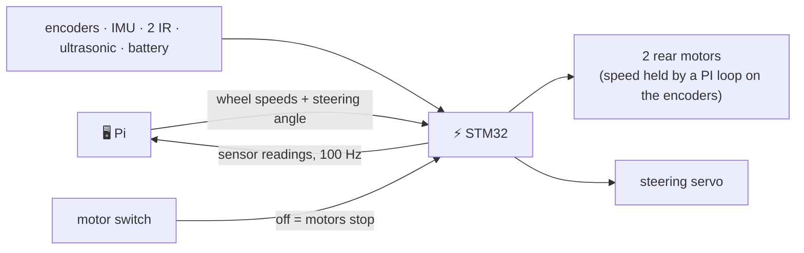

# STM32 (`mdp_stm32`)

The microcontroller that moves the car and reads its sensors. 100 times a second it takes two
numbers from the Pi - **wheel speed** and **steering angle** - and sends back every sensor reading.
All the thinking (planning, position) happens on the Pi. Board: STM32F407.

## System diagram



| Part | Hardware | What the firmware does |
| --- | --- | --- |
| Rear motors | 2 DC motors, AT8236 driver | Holds each wheel's speed: a **PI controller at 100 Hz** compares the target with the encoder count and adjusts the power. Tested 2-30 rad/s (up to ~1 m/s): within ±6 ticks of the target |
| Steering | HWZ020 servo | Turns the front wheels: 43.0° left (850 µs) to 32.5° right (2400 µs), centre 1490 µs |
| Encoders | Hall, 1560 ticks per wheel turn | Wheel speed, for the PI loop and the Pi |
| IMU | ICM-20948 | Turn rate and acceleration, for the Pi's position estimate |
| Distance | 2 × Sharp IR, HC-SR04 ultrasonic | Raw readings to the Pi (the Pi turns IR readings into cm) |
| Battery | ADC | Voltage, on the OLED and to the Pi |
| Safety | Motor switch (`PD3`), link watchdog | Switch off, or no command from the Pi for 0.5 s: the motors stop |
| Display | OLED + button | Status pages; the button flips pages or runs the self-test |

**Design in three lines:**

- **No RTOS**: plain interrupts, and the motor loop has the highest priority.
- **Wheel-speed control lives here**, not on the Pi: only the STM32 sees the encoders and drives the
  motors in the same instant.
- **One small binary message each way** over USB serial - [Serial Protocol](serial_protocol.md).

Build and flash: [Quickstart](../quickstart.md#1-install) (`pixi run flash` from `mdp_stm32/`).

## More

| Page | What it covers |
| --- | --- |
| [Firmware Architecture](architecture.md) | Interrupts and timing, each driver, pin map |
| [Control Tuning & Calibration](tuning.md) | The wheel-speed PI loop, steering calibration, IMU data |
| [Serial Protocol](serial_protocol.md) | The two messages byte by byte, the link watchdog |

```text
mdp_stm32/
├── platformio.ini     # board and build settings
├── include/           # one header per driver (motor, servo, encoder, imu, ir, ultrasonic, ...)
└── src/               # one .c per driver; main.c = start-up + main loop; usart.c = the serial link
```

??? note "Checking a freshly flashed board"

    !!! note "Separate debug and protocol UARTs"
        Debug `printf` output uses USART1 (USB Port 1); the Raspberry Pi binary protocol uses
        USART3 (USB Port 3). Connect the serial monitor to USART1 for the boot banner and debug output.

    **No host needed:**

    1. `pixi run flash` then `pixi run monitor` — confirm the boot banner prints, PE8 LED blinks, OLED cycles pages via the button.
    2. **Encoders:** spin a rear wheel by hand, watch OLED page 1 (`ENC`) — counts should change and sign should flip with direction.
    3. **Motor switch (`PD3`):** toggle it, watch OLED page 1's `ES:` field flip RDY/ENG. If it reads backwards, flip the comparison in `motor_estop_engaged()` (`motor.c`).
    4. **Servo:** should visibly center on boot. Real steering needs a host command (see below).
    5. **Distance sensors:** switch to OLED page 2, move an obstacle in front of `PC2` (IR1), `PC1` (IR2), or the ultrasonic sensor — confirm `IR1`, `IR2`, and `Ultra` distance readouts in `cm` respond accordingly.
    6. **Motors (normal operation):** remain stopped without an active host link; the self-test below is an exception — `uart_command_is_stale()` forces `motor_set_speed(0, 0)` within 500ms of boot if no command has ever arrived. This is the fail-safe working as intended, not a problem.

    **Routine self-test (no host needed):** The self-test runs rear wheels 1 revolution forward, 1 revolution back, then sweeps steering smoothly across its full range (center $\to$ left max $\to$ right max $\to$ center, 1° / 20 ms). PE8 blinks once for forward, twice for reverse, three times for servo sweep.
    Implemented in `mdp_stm32/src/selftest.c` (`selftest_run_if_requested()`).

    `PE0` (the user button) is dual-purpose, depending on *when* you press it and, during normal
    operation, the state of the `PD3` motor ON/OFF switch:

    | When you press it | `PD3` state | What happens |
    | --- | --- | --- |
    | Held through reset/power-on | Motor ON (ready) | Runs self-test before the main loop |
    | Held through reset/power-on | Motor OFF (disabled) | Refuses self-test, then enters the main loop |
    | Board already running normally | Motor ON (ready) | Runs the self-test sequence (can actually drive the motors) |
    | Board already running normally | Motor OFF (disabled) | Cycles the OLED page instead (self-test would just refuse anyway) |

    To trigger at boot, hold PE0 through reset with the PD3 motor switch enabled until the self-test starts.
    The OLED displays test status. Steering calibration routines are disabled by default; see
    [Calibration tooling](tuning.md#calibration-tooling) for details.

    **With the ROS2 bridge running** (wheels off the ground first):

    ```bash
    # /dev/stm32_serial (UART3, the car link): the udev rule from mdp_stm32 (pixi run udev); without it /dev/ttyACM0
    ros2 run mdp_bridge serial_bridge_node --ros-args -p serial_port:=/dev/stm32_serial

    # in other terminals:
    ros2 topic echo /joint_states   # live encoder-derived position/velocity
    ros2 topic echo /imu/data       # live accel/gyro
    ros2 topic echo /estop          # should match the PD3 switch state

    ros2 topic pub /joint_commands sensor_msgs/msg/JointState \
      "{name: ['lb_joint','rb_joint','left_joint','right_joint'], velocity: [2.0,2.0], position: [0.2,0.2]}" --once
    ```
    Wheels should spin slowly and the servo should turn — confirms the full STM32 -> Pi -> STM32 loop.

??? note "Re-tuning the wheel-speed PI loop"

    Do this before anything else builds on top of the wheel PID — see
    [Control Tuning: Closed-Loop Wheel Speed Control](tuning.md#closed-loop-wheel-speed-control) for why
    it's designed this way.

    1. Flash (`pixi run flash`), get the robot up on blocks so the wheels spin free.
    2. Send a step target via ROS (`ros2 topic pub /joint_commands ...` with a fixed `velocity` for
       `lb_joint`/`rb_joint`) or a temporary direct test in firmware — watch actual wheel behavior.
    3. Start from `MOTOR_PID_KI = 0` (pure P + feedforward). Raise `MOTOR_PID_KP` until the wheel
       tracks a step target quickly with acceptable overshoot (a little overshoot then settle is fine;
       visible oscillation/buzzing means back off).
    4. Reintroduce `MOTOR_PID_KI` in small steps, just enough to kill any remaining steady-state error
       (commanded rad/s vs. `motor_pid_get_measured_rad_s()`'s reading not converging) — too much causes
       slow oscillation/overshoot growing over time.
    5. Repeat for both wheels — since they're never perfectly matched, it's plausible (though not
       certain) the same gains work fine for both; watch for one wheel behaving worse than the other,
       which would call for asymmetric tuning instead of a shared `MOTOR_PID_KP`/`MOTOR_PID_KI`.
    6. Once tuned on blocks, re-verify on the ground with the actual chassis weight/friction before
       trusting it for real runs — this is a meaningfully different load than free-spinning wheels.

    If, after tuning, the car still curves during a straight `/cmd_vel` command, see
    [Control Tuning: Wheel-speed trim](tuning.md#wheel-speed-trim).
