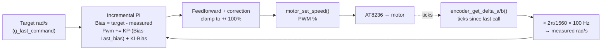

# Control Tuning & Calibration (`mdp_stm32`)

Closed-loop wheel-speed PID theory, servo range/steering calibration, and the IMU → `ros2_control`
→ `robot_localization` data flow. For hands-on bench-tuning steps, see
[STM32 overview → Re-tuning the wheel-speed PI loop](index.md).

---

## Closed-Loop Wheel Speed Control

A dedicated `TIM7` ISR runs at 100Hz and closes the loop per wheel:


<p align="center"><strong>Fig. 3</strong> — Wheel-Speed PID Loop (per wheel)</p>

The loop accumulates a PI correction from error changes and adds it to the speed-based
feedforward baseline. Correction and final PWM output are clamped; this is not an explicit
output slew-rate limiter.

The safety layers wrap the loop and always win: the 500ms stale-command fail-safe
(`uart_command_is_stale`) and the `PD3` motor switch check zero the PWM output unconditionally,
ahead of/around the PID — the PID can never override those.

`MOTOR_PID_KP=4.0f`/`MOTOR_PID_KI=0.5f` are untuned placeholder gains — see
[STM32 overview → Re-tuning the wheel-speed PI loop](index.md) for the tuning procedure.

**Limitation**: matching each wheel's own encoder-measured rad/s doesn't guarantee equal *real*
ground speed — different effective wheel radius/tire wear/alignment is invisible to the encoder.
A perfectly-tuned PID can still leave the car curving on a straight command — see
[Wheel-speed trim](#wheel-speed-trim) below.

### Wheel-speed trim

Not implemented — only add if the car still visibly curves on a straight `/cmd_vel` command *after*
the PID is bench-tuned and each wheel is confirmed tracking its own target correctly. If it drives
straight once tuned, skip this.

If needed: two constants, `MOTOR_LEFT_TRIM`/`MOTOR_RIGHT_TRIM` (default `1.0f`, neutral), applied to
`left_rad_s`/`right_rad_s` before `motor_pid_set_target()` — adjusts what the PID is asked to track,
not the PID itself. Tuned by feel: drive straight, see which way it curves, nudge the trim on the
lagging side, repeat.

---

## Servo Range & Steering Calibration

**Current values (re-measured 2026-09-18, in `servo.h` / `servo.c`): center 1490 µs, full left
43.0° at 850 µs (chassis contact), full right 32.5° at 2400 µs (confirmed mechanical stop).** One
servo drives the right wheel and a tie rod the left, so both wheels have the same angle. The rest of
this section is the 2026-09-11 measurement (35.0° / 29.5°), kept as the record of how it was done.

Everything below was measured on this chassis on 2026-09-11.

### Measured values

| | Pulse width | Real wheel angle | How it was found |
| --- | --- | --- | --- |
| Straight ahead | **1490 µs** | 0° | Motors off, car pushed by hand at candidate pulses until it rolled straight |
| Full left | **840 µs** | **+35.0°** (0.6109 rad) | Protractor at the wheel; limit is the wheel contacting the chassis |
| Full right | **2400 µs** | **−29.5°** (−0.5149 rad) | Protractor at the wheel; *not* a confirmed mechanical limit, see below |

Sign convention is REP-103: **positive = left**, negative = right. Confirmed on physical hardware
(observer behind the robot, facing the direction of travel). The servo's wiring and linkage already
agree with the ROS convention, so no sign translation happens anywhere in the stack — `mdp_bridge`
passes `steer_rad` through unmodified.

Center is **not** the nominal 1500 µs. At 1500 µs the car curved right when pushed by hand; 1490 µs
rolls straight. The hand push is what makes this measurement trustworthy — with the motors off,
neither wheel speed nor the PID can contribute, so anything left is steering geometry. A powered run
cannot distinguish a steering-center offset from a wheel-speed mismatch, since both curve the car.

### Real-angle → pulse mapping

`servo_set_angle(float angle_rad)` takes a **real wheel angle** — the same quantity the URDF and
`ackermann_steering_controller` mean. It interpolates linearly between center and the measured lock
point, with a **separate slope per side**:

```c
left  (angle >= 0):  pulse = 1490 + angle_rad × (−852.8)    /* 1490 → 850 µs over  43.0° */
right (angle <  0):  pulse = 1490 + angle_rad × (−1604.4)   /* 1490 → 2400 µs over 32.5° */
```

(Current values. With the 2026-09-11 endpoints the slopes were −1064.1 and −1767.4.)

Spans are 650 µs left and 910 µs right, so the two sides differ by roughly 1.4× — a single shared
slope cannot serve both. Real-angle resolution works out at ~0.054°/µs left and ~0.032°/µs right,
against `TIM12`'s 1 µs tick (`PSC=83` on the 84 MHz `TIM12CLK` gives a 1 MHz counter, so `CCR` *is*
the pulse width in microseconds).

Consequence worth noting: because the angle argument now means a real angle, `mdp_bridge`'s
straight pass-through of `steer_rad` is finally correct. Previously the controller's real angle was
fed into a differently-scaled unit, which under-steered left and clipped right. No bridge change was
needed to fix it.

### Calibration tooling

`selftest.c` provides button-advanced sweeps (one PE0 press per step, pulse width shown on the OLED).
Press PE0 during normal operation to run the self-test; no reset is needed, and the motor switch must
be enabled for it to proceed. Only the straight-line PI test is currently enabled;
calibration sweeps must be uncommented in `selftest_run()` before use.

| Phase | Purpose |
| --- | --- |
| `servo_straight_line_pid()` | Drives straight *through the PID loop*, showing both wheels' measured rad/s against target. The older `drive_ticks()` phases write open-loop PWM with the loop paused and cannot test it. |
| `servo_cal_center_trim()` | Steps the pulse down from 1500 µs, holding each step indefinitely with no timeout or auto-recenter, so the car can be hand-pushed repeatedly and power cut at the value that rolls straight. |
| `servo_cal_left_limit()` / `servo_cal_right_limit()` | Step outward from a known-safe pulse to find mechanical limits. |
| `servo_cal_verify_points()` | Drives to recorded `(pulse, angle)` points for re-measurement. |
| `servo_cal_measure()` | Coarse sweep across the range for protractor work at intermediate angles. |

**Calibrate in microseconds, never in an "angle" unit.** Microseconds is the only unit in the driver
that is physically meaningful on its own — it is the actual signal the servo receives. Calibrating
against a mapping's own input unit is circular. `servo_set_pulse_us()` exists for this and bypasses the angle-to-pulse mapping and operating
angle clamp; it is bounded only by `SERVO_CAL_PULSE_MIN/MAX_US`
(600–2500 µs), deliberately wider than the operating range so sweeps can probe past current limits.

When judging a limit, watch *and* listen. A servo stall is an audible buzz or whine with no visible
motion; chassis or linkage contact is the wheel or knuckle visibly binding while the servo still
strains. The limit is the last step that moved cleanly, not the one that stalled.

### Both wheels

Both front wheels track within a degree or two of each other across the sweep (857-2260 µs), so the
URDF's `left_joint` / `right_joint` share one limit pair.

## IMU → `ros2_control` → `robot_localization` Data Flow

### What should run where

```
STM32 (mdp_stm32)                    Pi (mdp_ros)
------------------                   ------------
imu_update():                        serial_bridge_node:
  read raw accel_x/y/z,     ----->     publish sensor_msgs/Imu:
  gyro_x/y/z over I2C                    angular_velocity  (raw gyro, rad/s)
  (software I2C PB10/11,                 linear_acceleration (raw accel, m/s^2)
  ICM-20948 registers                    [orientation: see below]
  0x2D-0x38 only — no mag)               [orientation: see below]
                                                |
                                                v
                                      robot_localization ekf_node:
                                        fuses angular_velocity_z (yaw rate,
                                        from BOTH this IMU input AND
                                        ackermann_steering_controller's own
                                        wheel-derived vyaw - redundant on
                                        purpose, see "Fix applied" below)
                                        + ackermann_steering_controller's
                                        v_x (wheel odometry)
                                        -> /odometry/filtered, odom->base_link TF
```

### What the EKF uses

The EKF fuses the **turn rate** (`vyaw`) from both the IMU and the wheels
(`ackermann_steering_controller`), each weighted by its covariance - so a dead IMU does not leave it
blind. The STM32's own gyro-integrated yaw has no drift correction, so the EKF does not use it; it
is only shown on the OLED. Details: [ROS2 EKF Localization](../rpi/ros2_ekf_localization.md).

### Why not fuse the magnetometer today

The ICM-20948 has an onboard AK09916 magnetometer, but `imu.c` never reads it (only accel+gyro
registers). Gyro-only yaw — whether integrated on the MCU or in the EKF — drifts unbounded with no
absolute reference to correct against. Adding mag support is real new work: extra I2C reads in
`imu.c`, publishing `sensor_msgs/MagneticField`, and typically running something like
`imu_filter_madgwick` upstream of the EKF to turn gyro+accel+mag into a single filtered orientation
(feeding raw mag straight into `robot_localization` isn't the normal pattern). Worth it for long
runs; likely unnecessary for short MDP checkpoint-to-checkpoint hops where drift over ~30s is small.
